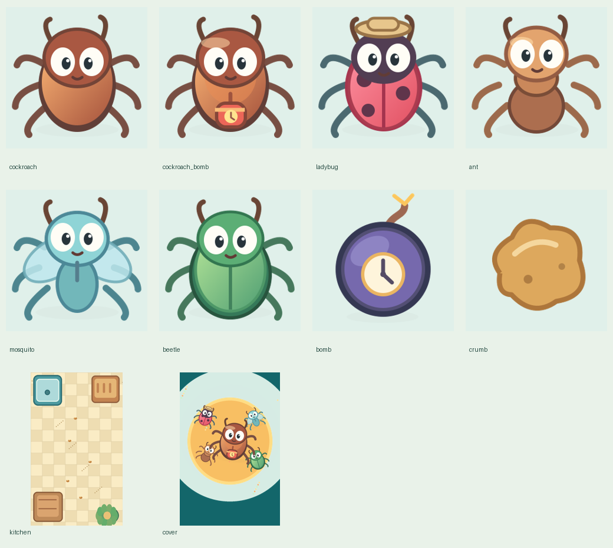

# 💣 BUG BOMB – Gián Siêu Quậy (Flutter demo)

Bản thử nghiệm game 2D dọc Android/iOS theo hướng **Kích nổ combo + Tìm bom giải cứu**. 10 màn, AI côn trùng, đếm ngược, bọ giáp, côn trùng vô hại, mini-game giải mã, level 10 hai pha, lưu tiến trình offline.



## Công nghệ
- Flutter/Dart 3.4+, không yêu cầu server.
- `shared_preferences: ^2.5.6` cho tiến trình cục bộ.
- PNG sprite minh họa vector do project tự tạo, **không phải ảnh tạo bằng GPT image generator**. Prompt thay thế GPT có ở `docs/image-prompts.md`.

## Khởi chạy
Yêu cầu [Flutter SDK](https://docs.flutter.dev/get-started/install), Android Studio + SDK cho Android, Xcode trên macOS cho iOS.

```bash
cd bug_bomb_flutter
flutter create --platforms=android,ios .  # tạo platform scaffolding nếu chưa có
flutter pub get
flutter run                           # chọn thiết bị Android/iOS
```

> Repo demo cố ý không chứa thư mục Android/iOS sinh theo máy; chạy `flutter create --platforms=android,ios .` một lần để tạo các cấu hình gốc. Nên thay package/application ID mặc định trước khi phát hành.

## Kiểm tra

```bash
flutter analyze
flutter test
```

## Build release và bảo vệ Dart code

```bash
bash tools/build_release.sh apk         # Android APK release, obfuscated
bash tools/build_release.sh appbundle   # Android AAB release, obfuscated
bash tools/build_release.sh ios         # macOS/Xcode, iOS release
```

Symbols nằm **ngoài** thư mục dự án, không commit lên GitHub. Xem `docs/code-protection.md`.

## Điều khiển
- Chọn level; level 1/2/5/7/9 dùng joystick góc trái và nút **BOOM!** góc phải.
- Level 3/4/6/8: chạm nhân vật nhấp nháy đèn đỏ, rồi nhập ký hiệu **☀ → ⭐ → 🌙**.
- Level 10: giải cứu trước, sau đó kích nổ.
- Tránh bọ rùa (vô hại) ở Level 5; bọ giáp Level 9 cần hai tác động.
- Có nút Pause, Retry, Next, lưu `unlocked` và sao tốt nhất.

## Trạng thái xác minh
- Mã nguồn và asset PNG đã tạo, kiểm tra alpha/kích thước sprite.
- **Chưa chạy Flutter compile/analyze/test, APK hoặc IPA** do môi trường tạo dự án không có Flutter/Dart SDK. Người nhận nên chạy các lệnh ở trên, sửa lỗi nền tảng nếu phát sinh, rồi thử trên thiết bị thật.

## Tài liệu
- `docs/idea.md`: ý tưởng và giả định.
- `docs/analysis.md`: gameplay, mô hình dữ liệu, giới hạn.
- `docs/design.md`: UI, art direction.
- `docs/features.md`: spec, plan, code review, test mapping.
- `docs/verification.md`: kiểm chứng và bước còn thiếu.
- `docs/image-prompts.md`: prompt GPT cho bộ sprite.
- `.agents/skills/demo-crud/SKILL.md`: hướng dẫn tiếp tục mở rộng tiến trình và inventory bằng `$demo-crud`.
